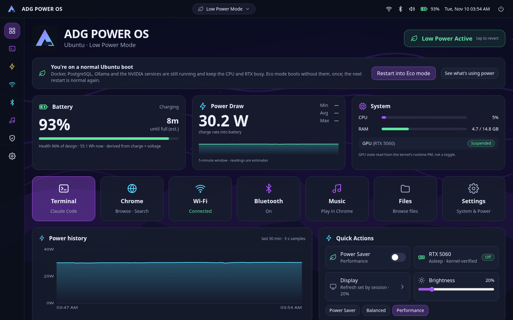
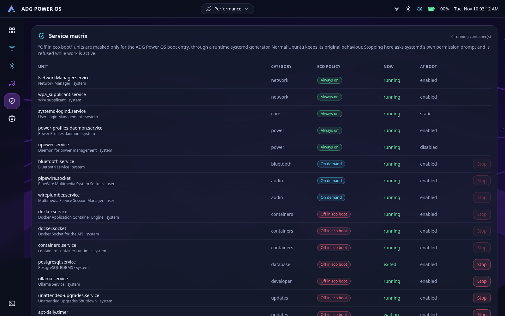
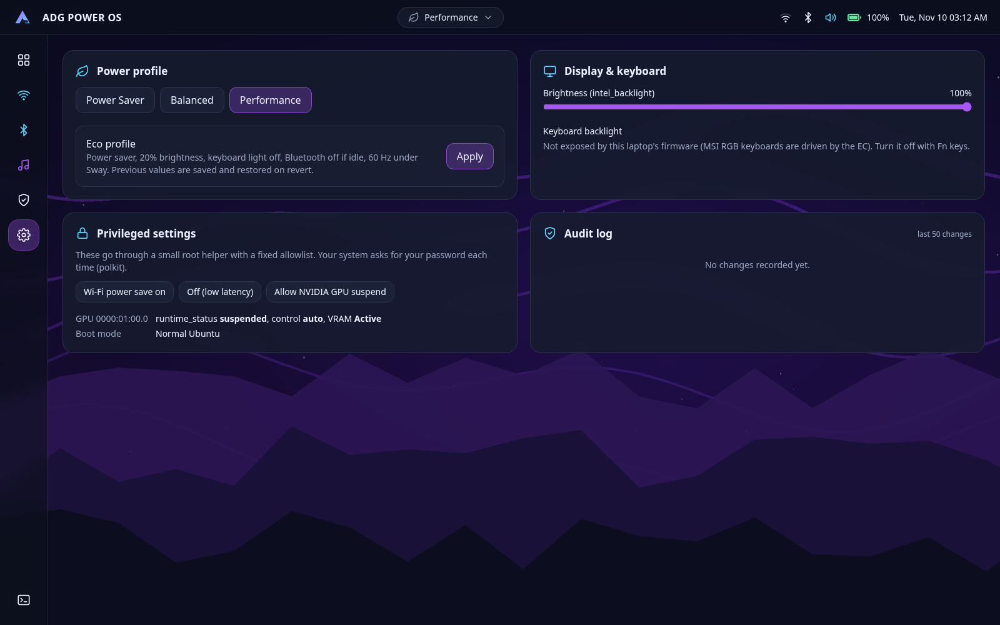

<p align="center">
  
</p>

<h1 align="center">ADG Power OS</h1>

<p align="center">
  <b>A reversible low-power Ubuntu session for developer laptops.</b><br/>
  Live battery telemetry, Wi-Fi, Bluetooth and audio controls, Claude Code one tap away,<br/>
  and an eco boot that switches off Docker, databases and indexers without touching normal Ubuntu.
</p>

<p align="center">
  
  
  
  
  
</p>



---

## Why

A gaming laptop with an RTX GPU, Docker, Postgres and a full GNOME desktop
burns 20–40 W doing nothing. For a day of terminal work, Claude Code and some
music, it should be closer to 10 W.

ADG Power OS is **not a new operating system**. It adds three things to a
stock Ubuntu install:

1. **A Sway session** you pick at the login screen, rendering on the iGPU only.
2. **A small Rust daemon** that measures what the battery is really doing and
   exposes safe controls to a dashboard.
3. **An optional "ADG Power OS" boot entry** that masks heavy background
   services for that boot only.

Pick "Ubuntu" at boot or login and everything is exactly as it was.

## Features

| | |
|---|---|
| 🔋 **Honest battery telemetry** | Watts, Wh, health and runtime from `/sys/class/power_supply`, auto-discovering any `BAT*` (no hard-coded `BAT0`). Derived values are marked as estimates, readings are smoothed, and runtime is hidden while charging or at zero draw. |
| 📈 **Power history** | One hour of 3-second samples with min/avg/max over 5 minutes and a crosshair chart. |
| 🎮 **Verified GPU state** | "Suspended" is shown only when the kernel's runtime PM says `suspended`, never from a toggle. |
| 📶 **Wi-Fi** | Scan, connect and disconnect through NetworkManager's D-Bus API. Passwords go straight to NetworkManager and are never logged or placed on a command line. Wi-Fi keeps working with the dashboard closed. |
| 🎧 **Bluetooth & audio** | Pair, trust, connect and forget through BlueZ, with a pairing agent that only accepts requests for 60 seconds after you ask. Pick the PipeWire output, set volume, and see what Chrome is playing (MPRIS). |
| 🌿 **Eco profile with rollback** | One tap sets power-saver, 20% brightness, keyboard light off, Bluetooth off if idle and 60 Hz under Sway. Previous values are saved and restored on revert. |
| 🛡️ **Service matrix** | Every eco-relevant unit with its live state and policy. Stops go through systemd's own polkit prompt and are refused while containers run or database clients are connected. |
| 🚀 **Launcher** | Claude Code in a terminal, Chrome, YouTube Music, files. Apps run in their own systemd scope, so closing the dashboard leaves them alone. |
| 📝 **Audit log** | Every change is appended to `~/.local/state/adg-power/audit.log`. |

<table>
  <tr>
    <td></td>
    <td></td>
  </tr>
  <tr>
    <td align="center">Service matrix</td>
    <td align="center">Settings, privileged controls and audit log</td>
  </tr>
</table>

## How it works

```
GRUB ── "Ubuntu" (untouched) ─────────────────────────────────────► normal boot
     └─ "ADG Power OS"  (+ adgpower.eco=1)
            │
            ├─ adg-power-eco-generator ─ masks Docker, containerd, k3s, databases,
            │                            updaters, indexers… in /run only
            └─ login → "ADG Power OS" session → Sway on the iGPU
                   │
                   ├─ adg-powerd  (user service, never root, ~5 MB RAM)
                   │     ├─ sysfs/procfs ─ battery, backlight, PCI runtime PM, CPU, RAM
                   │     ├─ D-Bus ─ NetworkManager · BlueZ · logind · UPower · systemd
                   │     │          · power-profiles-daemon · MPRIS
                   │     ├─ wpctl ─ PipeWire outputs (numeric ids only)
                   │     └─ pkexec ─ adg-power-helper (root, 2 allowlisted actions)
                   │
                   └─ adg-power-dashboard (Tauri) ─ invoke("daemon") ─► Unix socket (0600)
```

**Security model**

- The daemon and the dashboard run as you. The only root code is
  `adg-power-helper`, which accepts exactly two actions (GPU runtime PM and
  Wi-Fi power save), validates its arguments against sysfs and is gated by a
  polkit action.
- The API lives on a Unix socket in `$XDG_RUNTIME_DIR` with mode `0600`, so
  browsers and other users cannot reach it.
- No shell is ever spawned with user input. SSIDs and passwords are D-Bus
  values, unit names and device addresses are validated, and launcher apps
  come from a fixed allowlist.
- The eco generator writes only to `/run`. It refuses to mask
  NetworkManager, systemd or D-Bus units even if they are listed.

## Repository layout

| Path | What it is |
|---|---|
| [`crates/adg-powerd/`](crates/adg-powerd) | Rust daemon and library: telemetry, D-Bus adapters, policy, HTTP-over-Unix-socket API |
| [`crates/adg-powerd/src/bin/adg-power-helper.rs`](crates/adg-powerd/src/bin/adg-power-helper.rs) | Allowlisted root helper |
| [`app/`](app) | React + Tailwind dashboard; [`app/src-tauri/`](app/src-tauri) is the native shell |
| [`session/`](session) | Sway session launcher, Sway config, desktop entries |
| [`system/`](system) | systemd user unit, eco boot generator, GRUB entry script, polkit policy |
| [`scripts/`](scripts) | `discover.sh`, `install.sh`, `uninstall.sh`, `benchmark.sh`, `test-generator.sh` |
| [`docs/`](docs) | [Deployment](docs/deployment.md) · [Rollback](docs/rollback.md) · [Service matrix](docs/service-matrix.md) · [Power report](docs/power-report.md) |
| [`spec/`](spec) | The original engineering specification (PDF) |

## Getting started

### Requirements

- Ubuntu 24.04 or newer (developed on 26.04, kernel 7.0)
- Rust stable, Node 22 and pnpm
- Packages:

```bash
sudo apt install sway foot swaybg swayidle swaylock iw mate-polkit \
  libwebkit2gtk-4.1-dev libgtk-3-dev librsvg2-dev libssl-dev
```

### Try it without installing

```bash
cargo test                          # 32 tests: battery math, parsers, policy, helper validation
cargo run -p adg-powerd -- once     # one reading from your laptop
cargo run -p adg-powerd -- serve    # start the daemon

# in another terminal
cd app && pnpm install && pnpm dev  # dashboard at http://127.0.0.1:1420
# or the native window:
pnpm tauri dev
```

### Install

Every script is a dry run unless you pass `--apply`.

```bash
scripts/discover.sh                  # read-only hardware and service audit
scripts/install.sh                   # show exactly what will be installed
scripts/install.sh --apply           # session + daemon + helper + generator
```

Log out, click the gear on the login screen and choose **ADG Power OS**.
When you are happy with the session, add the boot entry:

```bash
scripts/install.sh --apply --grub    # backs up grub.cfg, adds one entry, verifies it
```

Remove everything with `scripts/uninstall.sh --apply`. See the
[rollback guide](docs/rollback.md) for every undo path.

## Power targets

| Profile | Target | Typical use |
|---|---|---|
| Deep Eco | 5–8 W | Terminal, Wi-Fi idle, dim display (aspirational) |
| Developer | 8–12 W | Claude Code, terminal, live telemetry |
| Connected | 10–15 W | Wi-Fi, Bluetooth audio, light browsing |
| Performance | 15 W+ | Builds, heavier browsing, GPU work |

These are **targets, not results**. `scripts/benchmark.sh` records five-minute
stabilised averages with the conditions that affect them (brightness, Wi-Fi,
dGPU state, CPU load, battery health). Measured numbers go in the
[power report](docs/power-report.md), and nothing is claimed until they are there.

## API

`adg-powerd` serves JSON on `$XDG_RUNTIME_DIR/adg-power/powerd.sock`:

```bash
adg-powerd call GET  /api/status
adg-powerd call GET  /api/history?minutes=10
adg-powerd call POST /api/eco/apply
adg-powerd call POST /api/profile '{"name":"power-saver"}'
curl --unix-socket "$XDG_RUNTIME_DIR/adg-power/powerd.sock" http://x/api/wifi/networks
```

Endpoints cover status, history, profile, brightness, keyboard backlight, the
eco profile and its revert, Wi-Fi, Bluetooth, audio, services, the launcher,
the helper and the audit log. See [`server.rs`](crates/adg-powerd/src/server.rs).

## Hardware notes

Built for and tested on an **MSI Cyborg 15 B13WFKG** (i7-13620H, RTX 5060
Laptop, `BAT1`). Nothing is model-specific, but a few things vary between laptops:

- Batteries that expose only `current_now` and `charge_now` (like this MSI)
  get derived watts, marked as estimates in the UI.
- MSI's RGB keyboard is driven by the embedded controller and isn't exposed
  to Linux, so the eco profile reports it as unsupported instead of pretending.
- NVIDIA runtime suspend needs the proprietary driver with
  `NVreg_DynamicPowerManagement=0x02`. The eco boot entry sets it.

## License

[MIT](LICENSE) © ADG Studios
